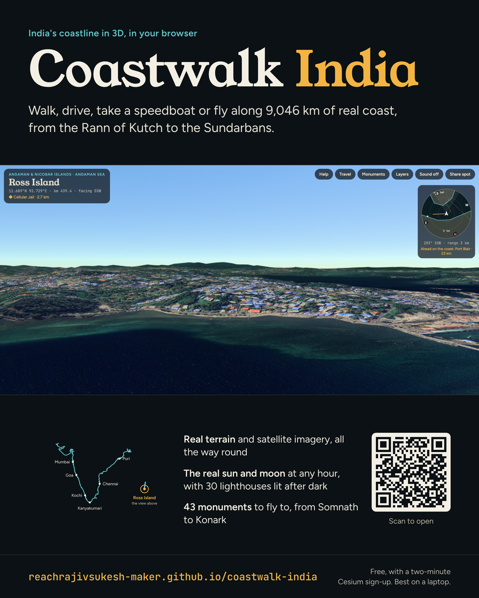

# Coastwalk India

Walk, drive, take a speedboat or fly along India's real coastline in 3D, from the Rann of Kutch round Kanyakumari to the Sundarbans, plus South Andaman and Kavaratti.

**Open the app:** https://reachrajivsukesh-maker.github.io/coastwalk-india/

## Getting started

1. Create a free Cesium ion account: https://ion.cesium.com/signup
2. Open your Access Tokens page and copy the **Default Token**: https://ion.cesium.com/tokens
3. Open the app, paste the token, and press **Start**.

The token is saved only in your browser and sent only to Cesium. The free Cesium plan is for personal, non-commercial use ([limits](https://cesium.com/platform/cesium-ion/pricing/)).

## What's in it

- Real terrain (Cesium World Terrain) with satellite imagery and OpenStreetMap buildings, plus optional photorealistic 3D cities
- Five ways to travel: Walk, Drive, Speedboat, Drone and Jet, with a Follow coast autopilot
- Animated surf along the shore, a speedboat that rides the swell, and fishermen at the big fishing harbours
- The real sun and moon for any time of day, with 30 lighthouses that sweep their beams at night
- 43 monuments and famous places, a heading-up radar, and a travel map you can drag along the coast
- Share spot links that open the app at an exact place, mode and time

Press **Help** inside the app for controls. Works best in Chrome, Edge or Safari on a laptop or desktop.

## Hosting your own copy

This is a static site with no build step. Fork the repository and turn on GitHub Pages (Settings → Pages → Deploy from a branch → `main`, `/ (root)`).

To let visitors start without their own token, put a restricted token in `config.js`. Limit it to assets 1, 2, 96188 and 2275207 and to your site's address under Allowed URLs. Everyone then uses your Cesium quota.

## Credits

CesiumJS and three.js · Cesium World Terrain · Bing Maps imagery via Cesium ion · © OpenStreetMap contributors · Coastline from Natural Earth (public domain)
